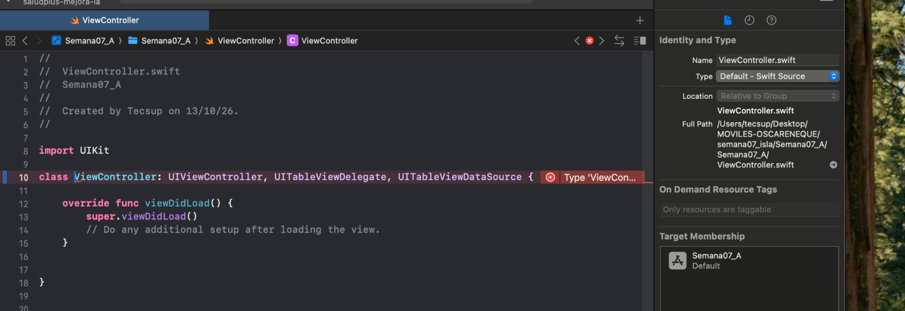
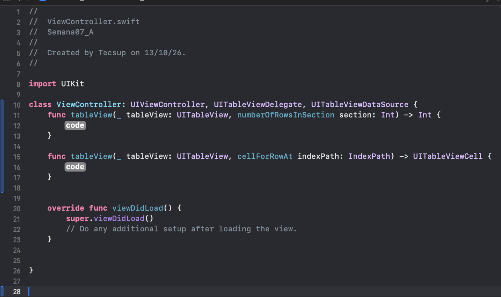
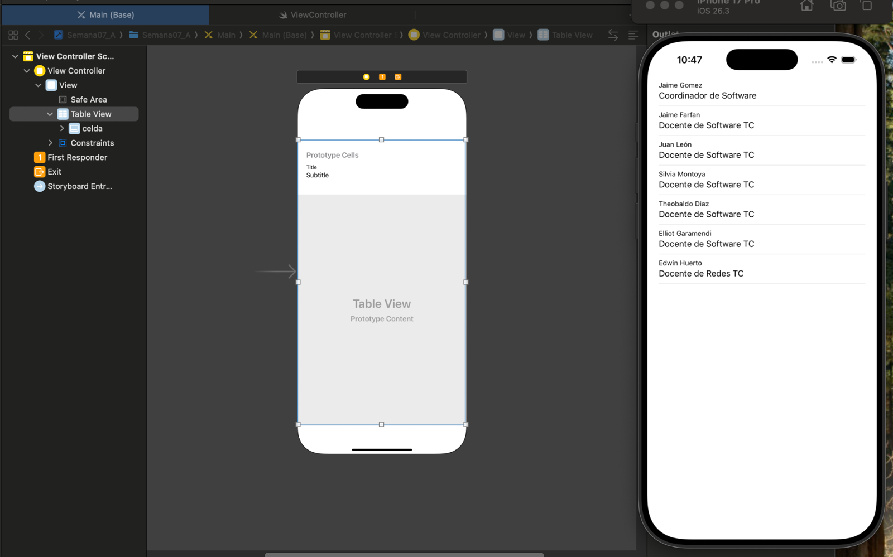
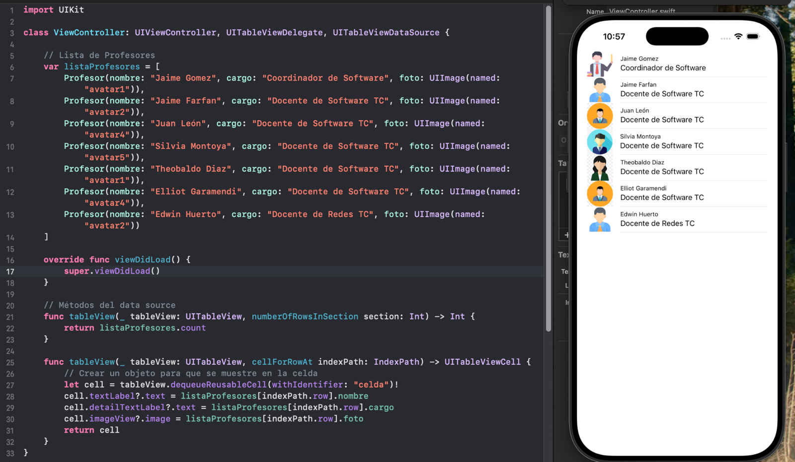
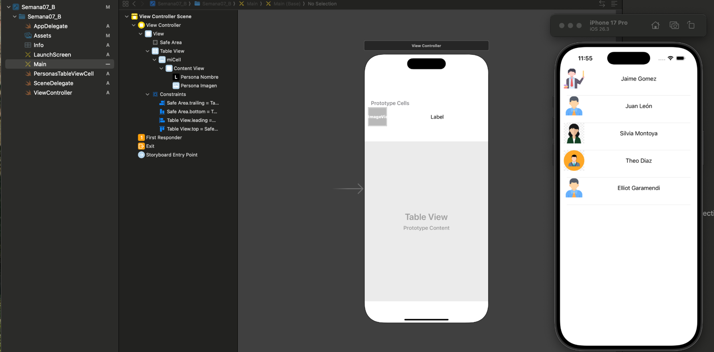
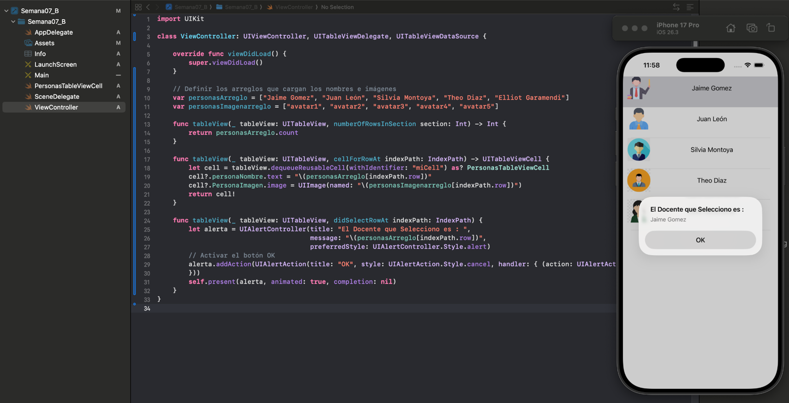

# Laboratorio 07: Manejo de Datos – Tablas y Colecciones

**Alumno:** Pablo Isla Arone  
**Curso:** Programación en Móviles Avanzado  
**Docente:** Juan León

---

## Rama `manual`

### A. Lista de profesores con UITableView (`Semana07_A/`)
Se creó un proyecto UIKit con un **Table View** ajustado a los bordes con constraints. A la celda prototipo se le puso el Identifier `celda` y el estilo **Subtitle**, y luego se conectaron el **dataSource** y el **delegate** al View Controller.

Al agregar los protocolos `UITableViewDelegate` y `UITableViewDataSource`, Xcode marca un error, porque todavía faltan los métodos obligatorios. Con el **Fix** (o escribiéndolos) aparecen los dos métodos: `numberOfRowsInSection`, que devuelve cuántas filas hay, y `cellForRowAt`, que llena cada fila.

Para los datos se creó la clase `Profesor` (subclase de `NSObject`) con `nombre` y `cargo`. Después se le agregó el campo `foto` de tipo `UIImage`, y las imágenes `avatar1` a `avatar5` se colocaron en **Assets**.

**Evidencias:**

Error al agregar los protocolos, antes de implementar los métodos:

Los dos métodos que agrega el Fix:

Primera ejecución: nombre y cargo con el estilo Subtitle:

Lista final con la foto de cada profesor:

### B. Personalizar un TableView (`Semana07_B/`)
En lugar del estilo Subtitle, se diseñó una celda propia con un **Image View** y un **Label**. Se creó la clase `PersonasTableViewCell` (subclase de `UITableViewCell`), se asignó como **Class** de la celda (Identifier `miCell`) y se conectaron los outlets `PersonaImagen` y `personaNombre`.

En `ViewController` los datos están en dos arreglos, uno de nombres y otro de imágenes. Además, con `didSelectRowAt` se muestra un `UIAlertController` con el nombre del docente seleccionado.

> **Lo que aprendí resolviendo errores:** la clase `PersonasTableViewCell` va en la **celda**, no en el Table View; si se pone en la tabla, desaparecen los outlets `dataSource` y `delegate`. Además, los controles de la celda deben conectarse a la clase de la celda: si se conectan al ViewController, Xcode muestra el error *"The outlet from the ViewController to the UIImageView is invalid"*.

**Evidencias:**

Celda personalizada en el Storyboard y lista en el simulador:

Alerta al seleccionar un docente:

---

## Conclusiones

**1.** El `UITableView` es la forma más práctica de mostrar listas de datos en UIKit. Funciona gracias a dos protocolos: `UITableViewDataSource`, que le dice a la tabla cuántas filas tiene y qué va en cada celda, y `UITableViewDelegate`, que responde a lo que hace el usuario, como tocar una fila. Además, gracias a `dequeueReusableCell` y al Identifier de la celda prototipo, la app reutiliza las celdas en lugar de crear una nueva por cada elemento, así que ahorra memoria aunque la lista sea grande.

**2.** Organizar los datos en una clase modelo hace que el código sea más ordenado y fácil de ampliar. En este laboratorio, las clases `Profesor` y `Cultura` agrupan en un solo objeto el nombre, el cargo o la región, la descripción y la imagen; por eso, agregar un campo nuevo, como la foto, solo exigió cambiar la clase y la línea que llena la celda. También comprobamos que las imágenes deben estar en Assets con el nombre exacto que se usa en `UIImage(named:)`; de lo contrario, simplemente no se muestran.

**3.** Personalizar la celda y navegar a una vista de detalle permite crear apps más completas. Al crear `PersonasTableViewCell` y `CulturaTableViewCell` aprendimos que los outlets de los controles de la celda deben conectarse a la clase de la celda y no al ViewController, porque Xcode lo marca como error. Por otro lado, con `didSelectRowAt`, `performSegue` y `prepare(for:sender:)` pudimos pasar la cultura seleccionada a una segunda pantalla, igual que en el Lab06, pero esta vez a partir de una fila de la tabla.

---

> Los pasos del Storyboard están en [GUIA_STORYBOARD.md](GUIA_STORYBOARD.md).  
> El caso a desarrollar (Culturas Peruanas) está en la rama `ai-assisted`.
