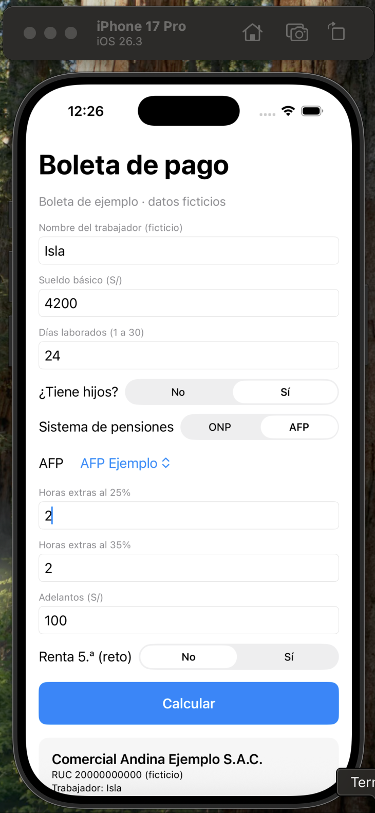
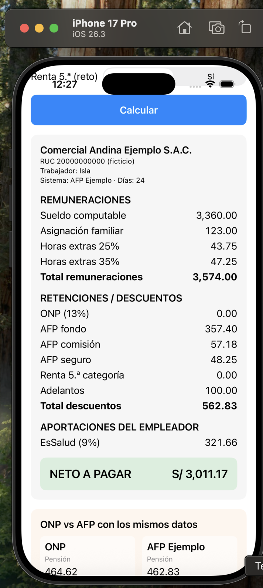
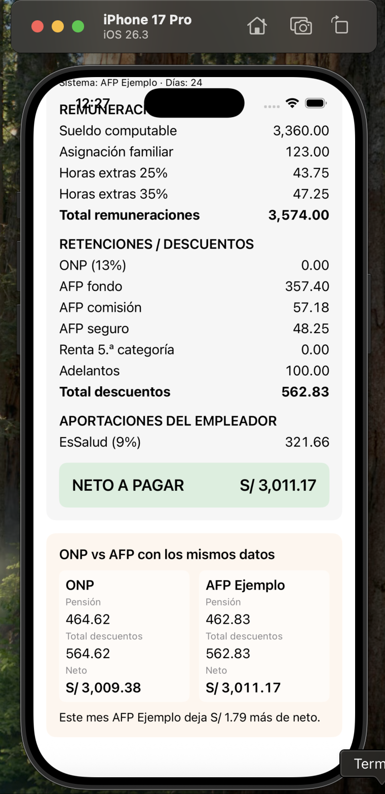
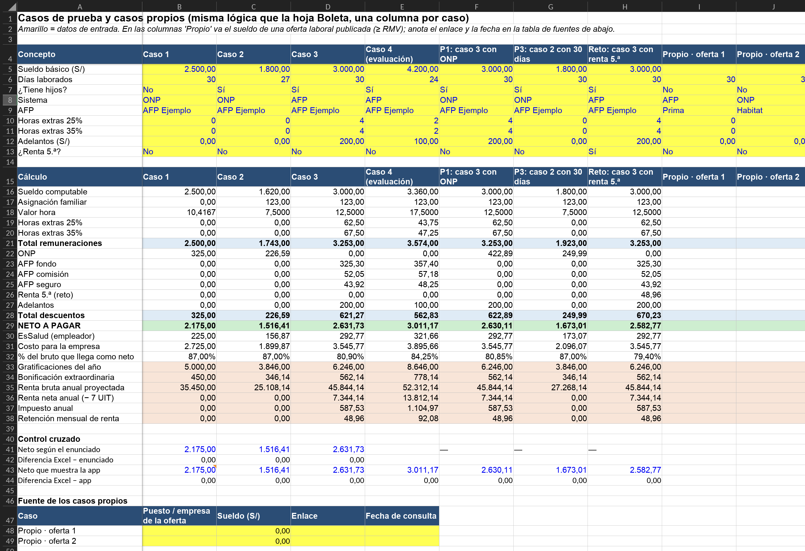

# Semana 10: Boleta de pago, del sueldo al neto

App SwiftUI de una sola pantalla que calcula la boleta de pago, más un Excel que explica y valida cada fórmula.

## Estructura

```
SEMANA10/
├── BoletaPago/
│   ├── BoletaPago/
│   │   ├── BoletaPagoApp.swift     # punto de entrada (@main)
│   │   ├── ContentView.swift       # pantalla única: formulario + boleta (ScrollView)
│   │   ├── Boleta.swift            # clase que calcula (arrays de remuneraciones y descuentos)
│   │   ├── Modelos.swift           # structs DatosTrabajador, TasaAFP, Concepto + validación
│   │   └── Parametros.swift        # RMV, tasas y diccionario de AFP (único lugar con números)
│   └── BoletaPagoTests/
│       └── BoletaPagoTests.swift   # casos 1 a 4 del enunciado
├── Boleta_de_Pago.xlsx             # hojas Parámetros, Boleta, Casos y Explicación
├── ANALISIS.md                     # 5 preguntas de análisis + tabla de fuentes
├── PROMPTS.md
├── evidencias/                     # capturas del simulador y del Excel
├── Semana10_BoletaPago_Evidencias.pdf
└── Semana10_BoletaPago.zip         # todo lo anterior en un solo archivo
```

## Cómo iniciarlo

1. En Xcode: **File → New → Project → iOS → App**, nombre `BoletaPago`, interfaz **SwiftUI**, marcar **Include Tests**.
2. Borrar el `ContentView.swift` y el `BoletaPagoApp.swift` que crea Xcode.
3. Arrastrar los 5 archivos de `BoletaPago/BoletaPago/` al grupo `BoletaPago` (marcar *Copy items if needed*).
4. Arrastrar `BoletaPagoTests.swift` al target de tests.
5. Correr con **⌘R** en un iPhone del simulador. Los tests se corren con **⌘U**.

El Excel se abre directo; solo se editan las celdas amarillas de la hoja **Boleta** o **Casos**.

## Capturas

| Formulario (caso 4) | Boleta (caso 4) | ONP vs AFP (caso 4) |
| --- | --- | --- |
|  |  |  |


