# Semana 11 · Grupo A · Caso Ventas (UIKit + Core Data)

App de una tienda que registra productos, clientes y ventas, con login, registro y dos roles (Vendedor y Supervisor). Las pestañas del `UITabBarController` cambian según el rol.

## Estructura

```
GrupoA_Ventas/
├── EXPEDIENTE.md                       modelo, permisos, reglas, pantallas, casos y plan
├── PROMPTS.md
├── evidencias/                         capturas del simulador (casos 1 a 9)
└── Ventas/
    ├── Ventas.xcodeproj
    └── Ventas/
        ├── AppDelegate.swift           persistentContainer (Core Data)
        ├── SceneDelegate.swift         pantalla inicial: login
        ├── Ventas.xcdatamodeld         Usuario, Producto, Cliente, Venta
        ├── BaseDeDatos.swift           contexto, guardar y consultas de Usuario
        ├── Sesion.swift                usuario conectado y cambio login <-> pestañas
        ├── Reglas.swift                categoría, descuento, IGV y formatos
        ├── Estilo.swift                piezas visuales compartidas
        ├── LoginViewController.swift           A1
        ├── RegistroViewController.swift        A2
        ├── MainTabBarController.swift          pestañas por rol + Cuenta
        ├── ProductosViewController.swift       A3
        ├── ClientesViewController.swift        A4
        ├── NuevaVentaViewController.swift      A5
        ├── VentasViewController.swift          A6, A7 y A8
        ├── ResumenViewController.swift         A9
        └── DatosDemo.swift             datos de ejemplo (argumento -datosDemo)
```

## Cómo iniciarlo

1. Clonar el repo y cambiar a la rama `ai-assisted`:
   ```
   git clone https://github.com/pabloislaarone/MOVILESAVANZADOS_ISLA.git
   cd MOVILESAVANZADOS_ISLA
   git checkout ai-assisted
   ```
2. Abrir `SEMANA11/GrupoA_Ventas/Ventas/Ventas.xcodeproj` en Xcode.
3. Elegir un simulador de iPhone y ejecutar con ▶ (⌘R).
4. Crear una cuenta (Vendedor o Supervisor) desde el login.

Para entrar con datos de ejemplo: **Product ▸ Scheme ▸ Edit Scheme ▸ Run ▸ Arguments** y agregar `-datosDemo`. Así se cargan los usuarios `cruiz` y `adiaz` (clave `123456`, Vendedor), además de productos, clientes y ventas de los últimos días.

## Resultados

| A1 Login | A2 Crear cuenta | A3 Productos | A4 Clientes |
|---|---|---|---|
| 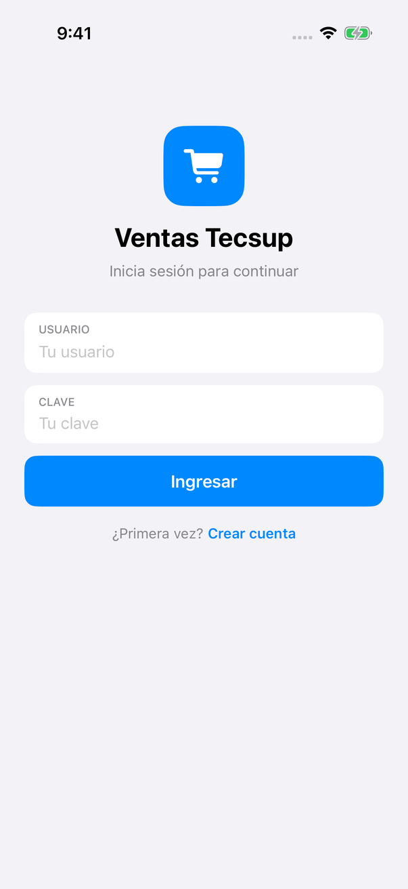 | 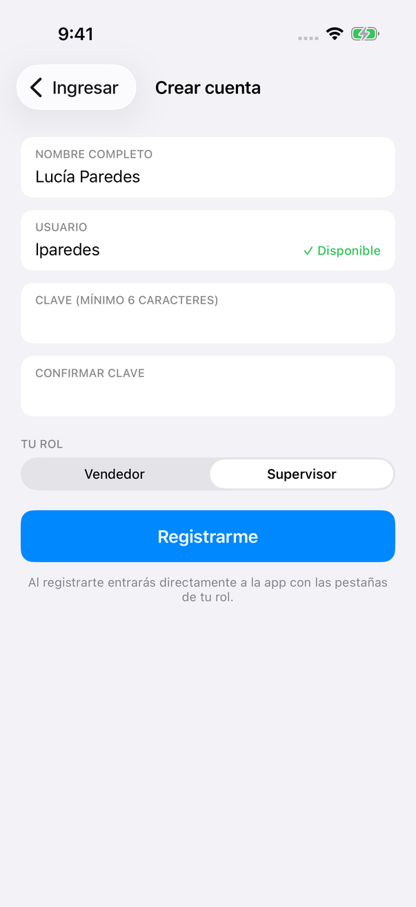 | 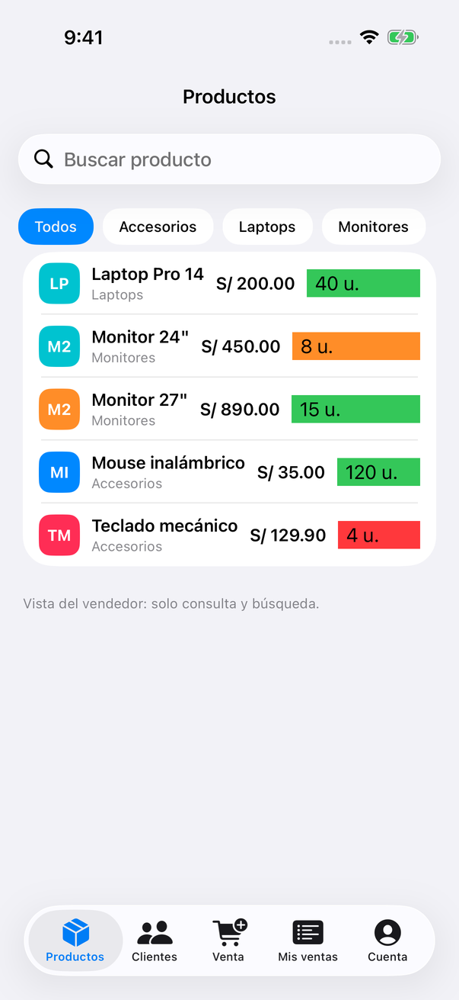 | 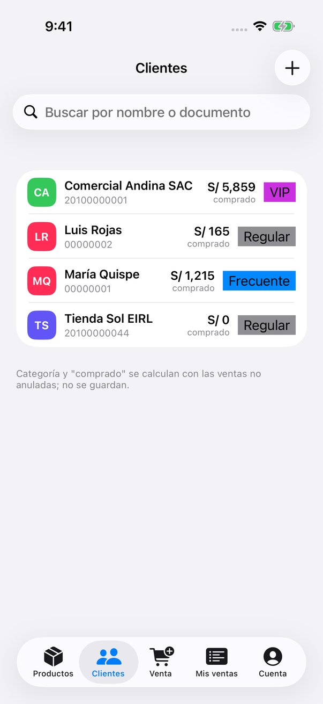 |

| A5 Nueva venta | A6 Mis ventas | A7 Ventas del equipo | A8 Anular venta |
|---|---|---|---|
| 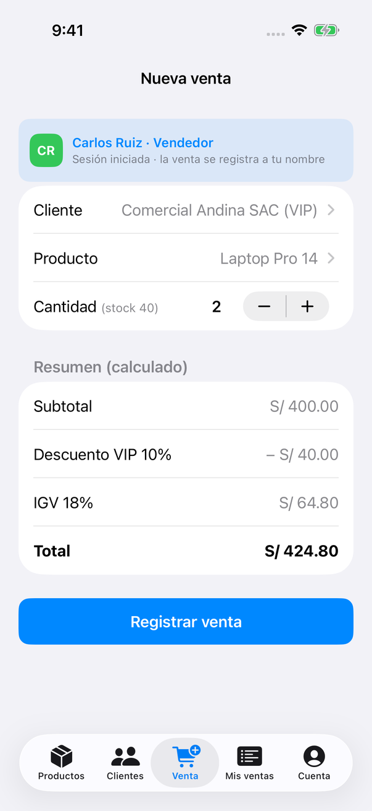 | 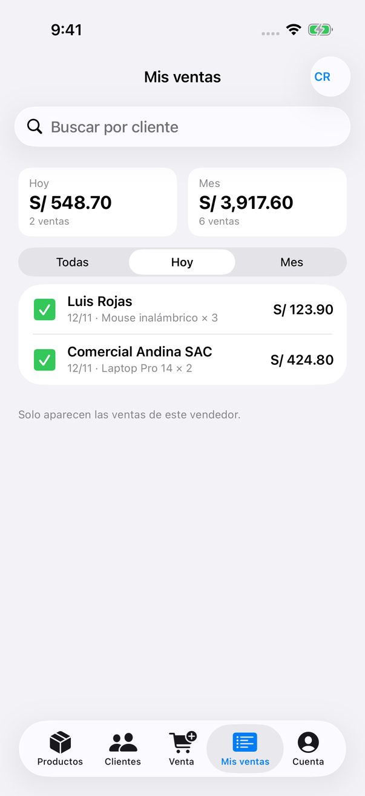 | 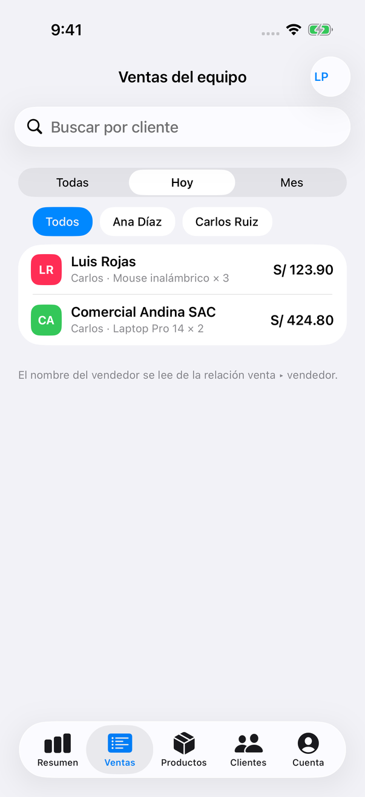 | 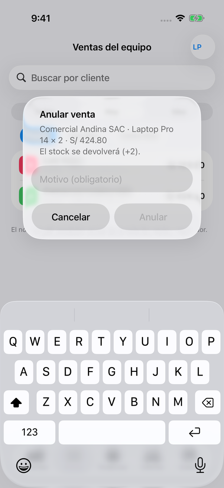 |

| A9 Resumen | Cuenta | Ícono | Venta anulada |
|---|---|---|---|
| 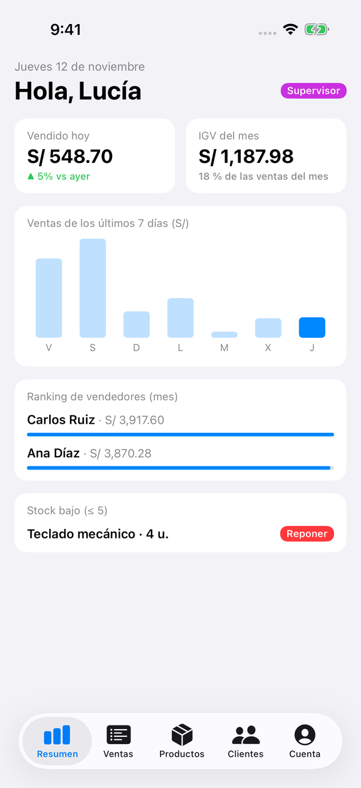 | 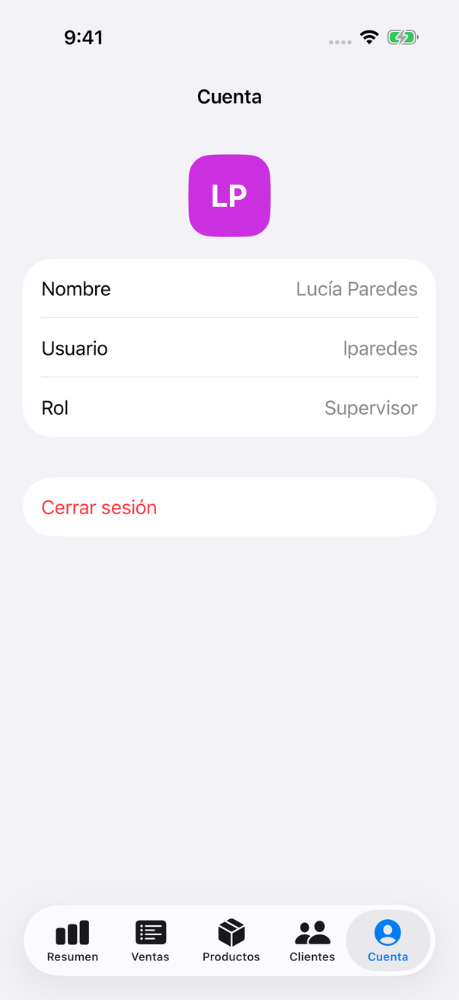 | 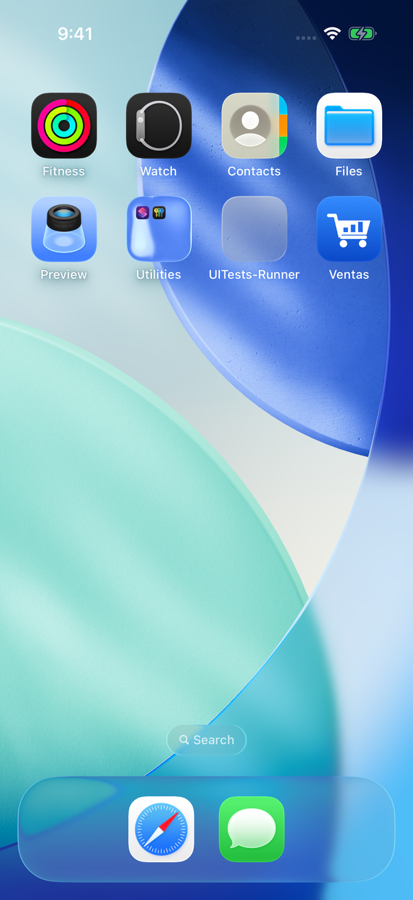 | 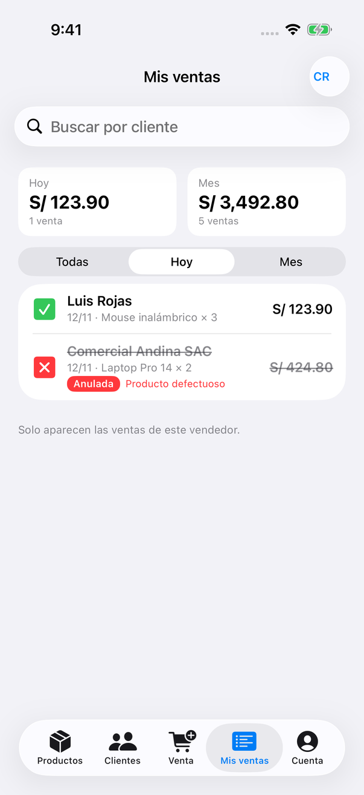 |

## Casos de prueba

| N.º | Caso | Resultado | Capturas |
|---|---|---|---|
| 1 | Registrar lparedes (Supervisor) y repetir LPAREDES | Entra a la app; el repetido se rechaza | 04_caso1_entra_supervisor, 06_caso1_usuario_repetido |
| 2 | Clave de 4 caracteres / claves distintas | Mensaje de error, no se crea | 07_caso2_clave_corta, 08_caso2_claves_distintas |
| 3 | Login con clave incorrecta | "Usuario o clave incorrectos" | 02_caso3_clave_incorrecta |
| 4 | 2 Laptop × S/ 200 a cliente VIP | 400.00 · −40.00 · 64.80 · **424.80** · stock 40 → 38 | 12_A5_caso4_resumen, 13_caso4_registrada_stock_38, 17_caso4_stock_38 |
| 5 | 3 Mouse × S/ 35 a cliente Regular | 105.00 · 18.90 · **123.90** | 14_caso5_resumen |
| 6 | 50 unidades con stock 40 | Alerta; no se registra | 11_caso6_stock_insuficiente |
| 7 | Vendedor abre Mis ventas | Solo sus ventas, sin Anular | 15_A6_caso7_mis_ventas, 16_caso7_sin_anular |
| 8 | Anular el caso 4 sin y con motivo | Anulada, stock vuelve a 40, resumen 548.70 → 123.90 | 20 a 24, 27_caso8_resumen_baja |
| 9 | Borrar cliente con ventas | Se impide con mensaje | 26_caso9_borrar_cliente_con_ventas |
