# Semana 11: Persistencia con Core Data y SwiftData

**Alumno:** Pablo Isla Arone  
**Curso:** Programación en Móviles Avanzado

---

## Estructura

```
SEMANA11/
├── Actividad01_CoreData/
│   └── lab11/                                  (UIKit + Storyboard + Core Data)
│       ├── lab11.xcodeproj
│       └── lab11/
│           ├── AppDelegate.swift               persistentContainer
│           ├── SceneDelegate.swift
│           ├── ViewController.swift            CRUD de contactos
│           ├── ViewController+Relacion.swift   fetch requests con predicate
│           ├── lab11.xcdatamodeld              entidad Contacto
│           └── Base.lproj/Main.storyboard
├── Actividad02_SwiftData/
│   └── apple_lab11_02_SwiftUI_SwiftData/       (SwiftUI + SwiftData)
│       ├── apple_lab11_02_SwiftUI_SwiftData.xcodeproj
│       └── apple_lab11_02_SwiftUI_SwiftData/
│           ├── apple_lab11_02_SwiftUI_SwiftDataApp.swift
│           ├── Alumno.swift                    @Model
│           ├── Curso.swift                     @Model (1 a muchos)
│           ├── ModelContainerProvider.swift    contenedor SQLite (singleton)
│           ├── ContentView.swift               lista, detalle, búsqueda, delete
│           ├── NuevoAlumnoView.swift           create
│           └── EditarAlumnoView.swift          update con @Bindable
└── evidencias/
    ├── actividad01/
    └── actividad02/
```

## Cómo abrirlo

1. Clonar el repo y cambiar a la rama `manual`:
   ```
   git clone https://github.com/pabloislaarone/MOVILESAVANZADOS_ISLA.git
   cd MOVILESAVANZADOS_ISLA
   git checkout manual
   ```
2. Abrir en Xcode el `.xcodeproj` de la actividad:
   - `SEMANA11/Actividad01_CoreData/lab11/lab11.xcodeproj`
   - `SEMANA11/Actividad02_SwiftData/apple_lab11_02_SwiftUI_SwiftData/apple_lab11_02_SwiftUI_SwiftData.xcodeproj`
3. Elegir un simulador de iPhone y ejecutar con ▶ (⌘R).

> Si al ejecutar sale un error de migración, borra la app del simulador y vuelve a ejecutar.

## Resultados

### Actividad 01: Core Data con UIKit (Contacto)

Agenda de contactos con las cuatro operaciones del CRUD. Los datos se guardan en el SQLite de la app y siguen ahí al volver a ejecutarla.

| Agregar | Lista | Eliminar | Editar |
|---|---|---|---|
| 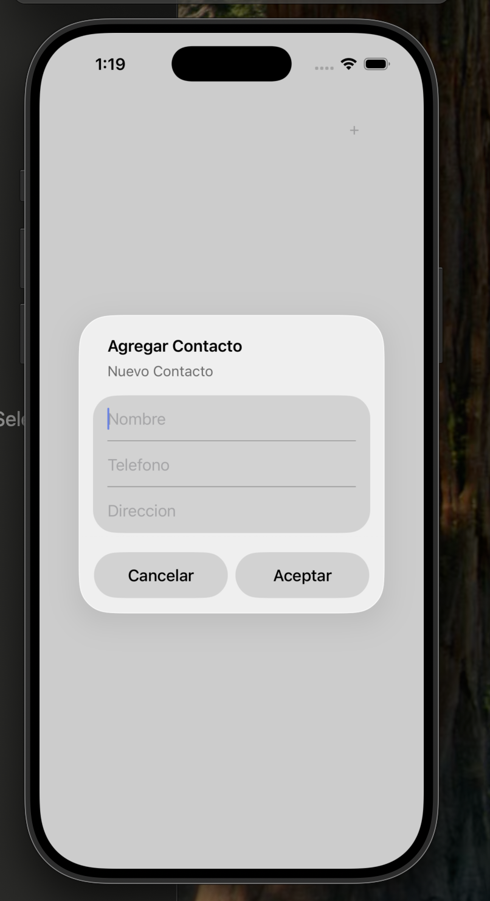 | 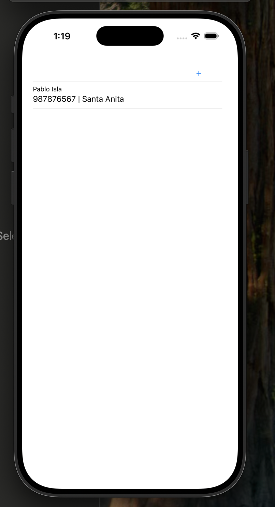 | 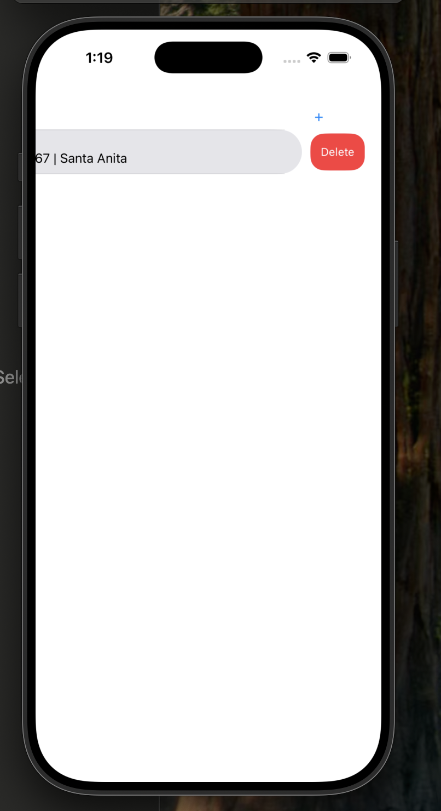 | 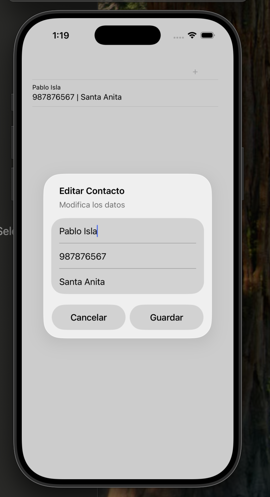 |

### Actividad 02: SwiftData con SwiftUI (Alumno)

Lista de alumnos con crear, ver detalle, editar, eliminar y buscar por apellido. La vista se actualiza sola con `@Query`.

| Nuevo alumno | Lista | Detalle | Editar | Detalle actualizado |
|---|---|---|---|---|
| 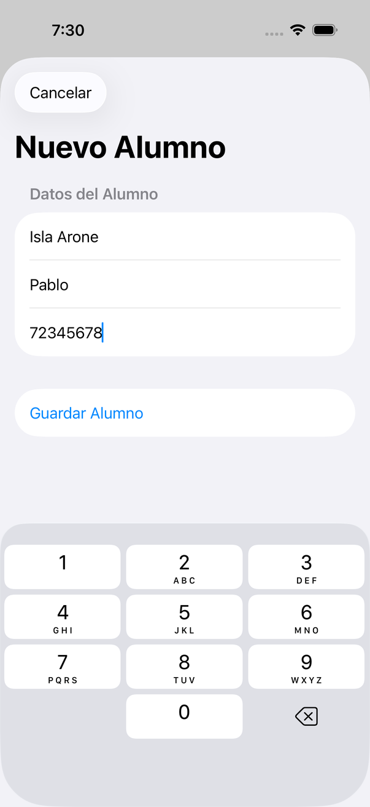 | 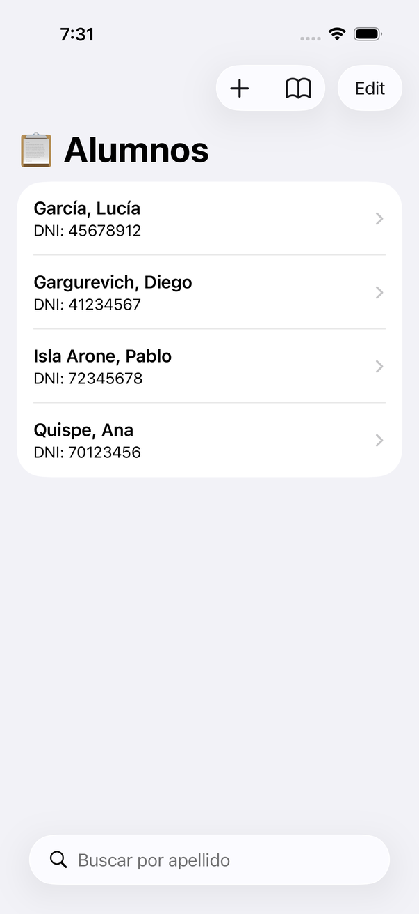 | 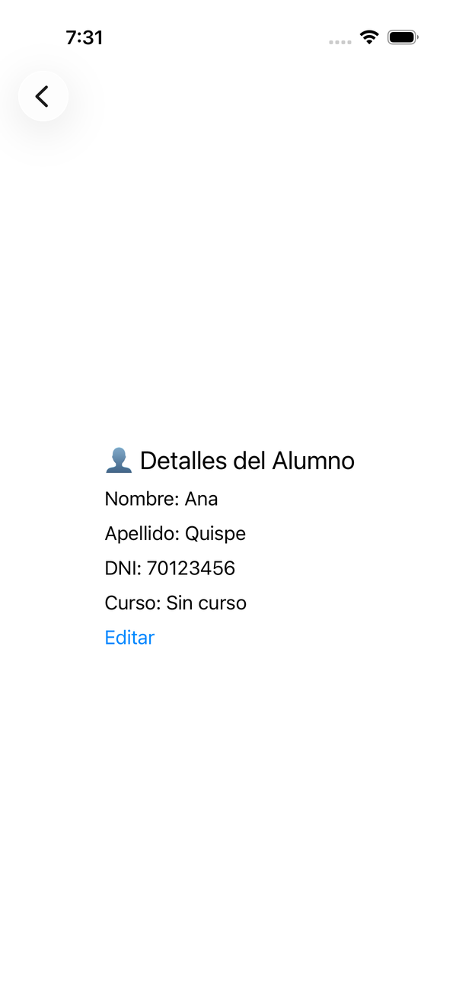 | 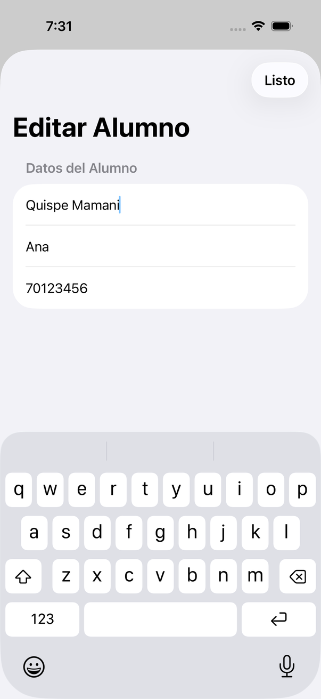 | 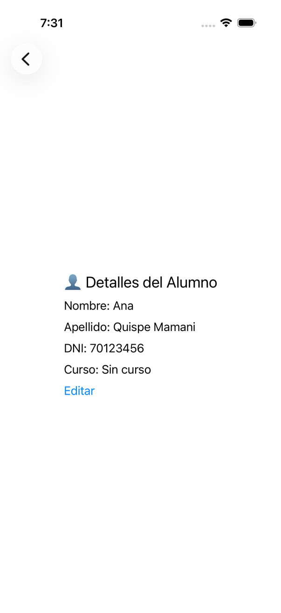 |

| Persistencia al reabrir | Buscar "gar" | Eliminar | Lista tras eliminar | Curso asignado |
|---|---|---|---|---|
| 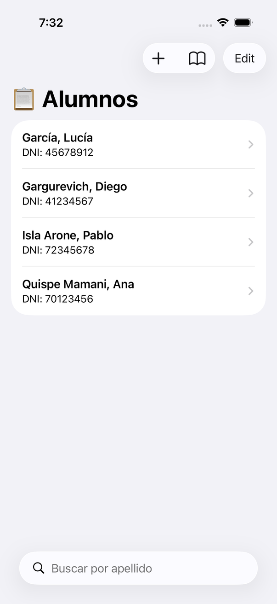 | 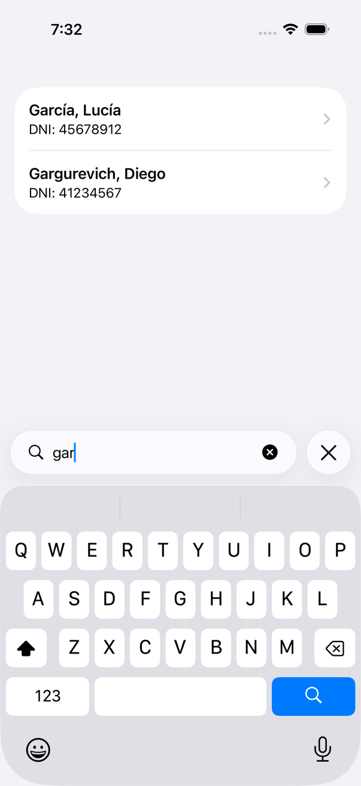 | 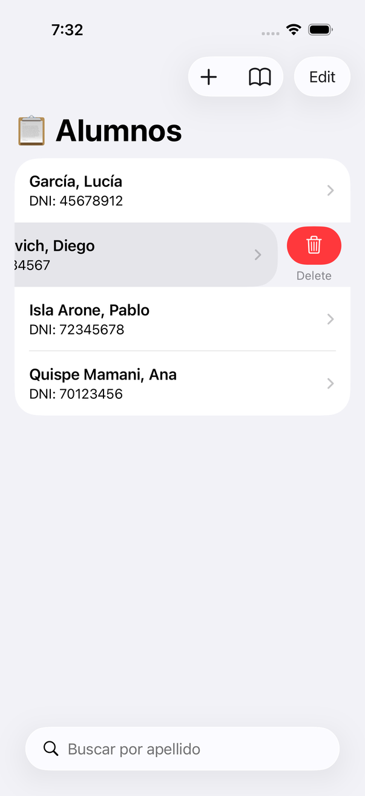 | 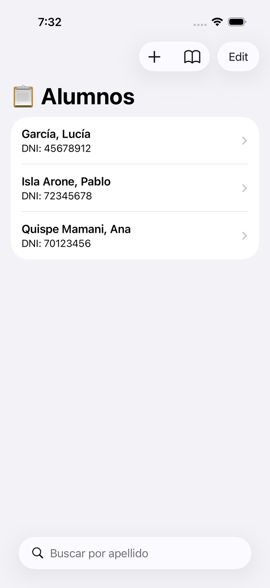 | 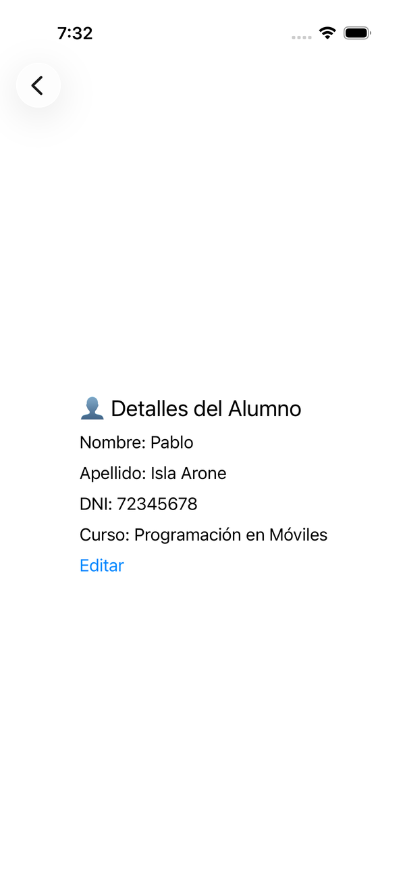 |

## Evidencias

- [`Lab11_Evidencias.pdf`](Lab11_Evidencias.pdf)
